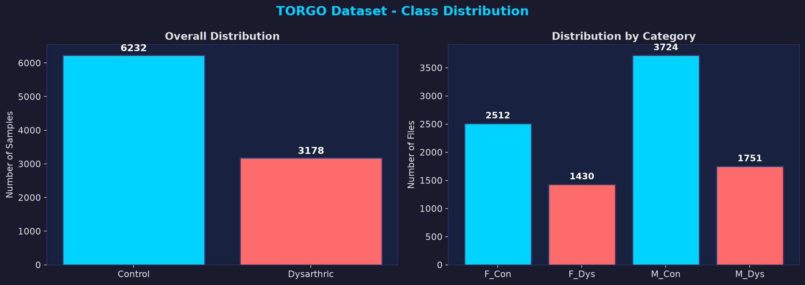
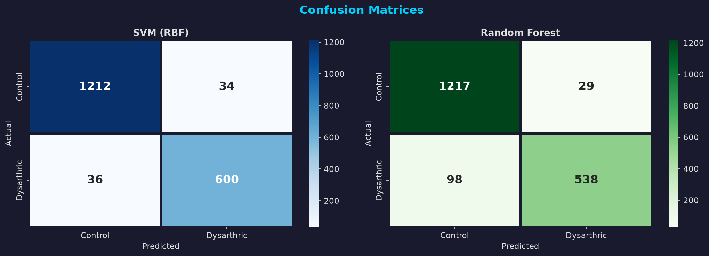
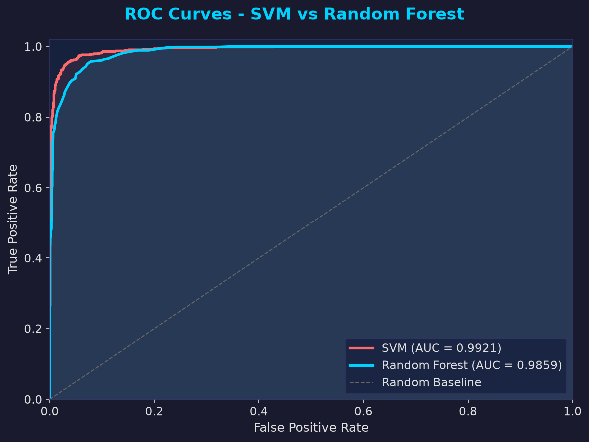
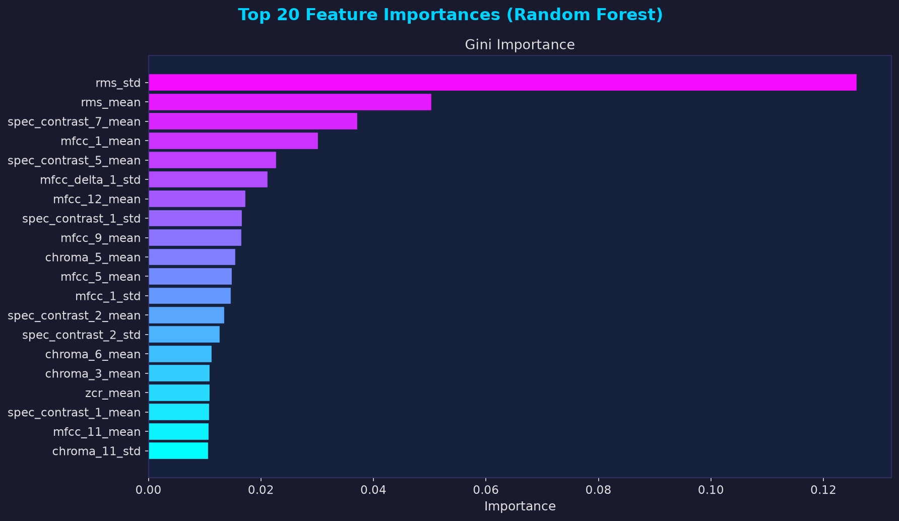
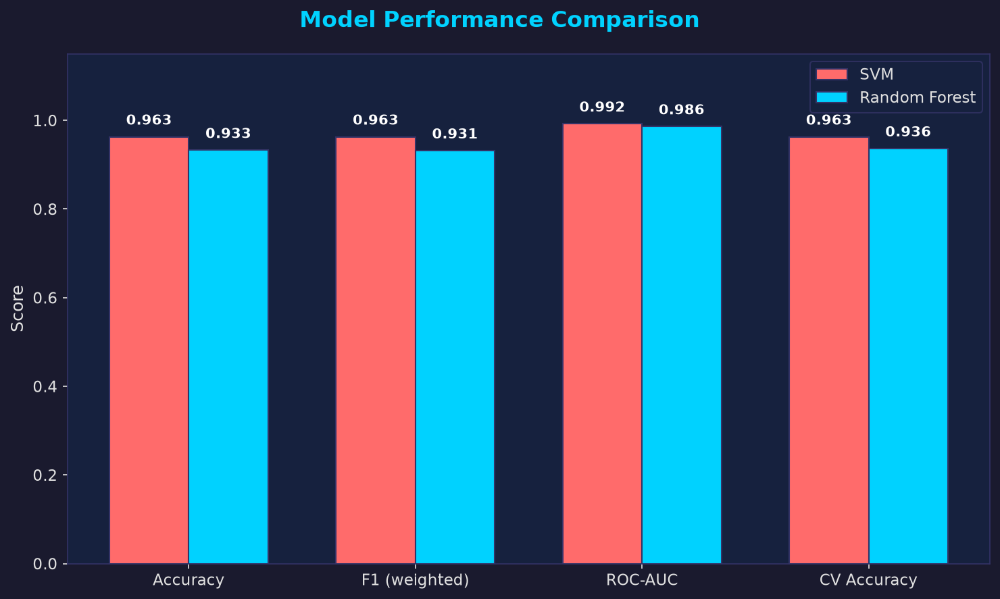
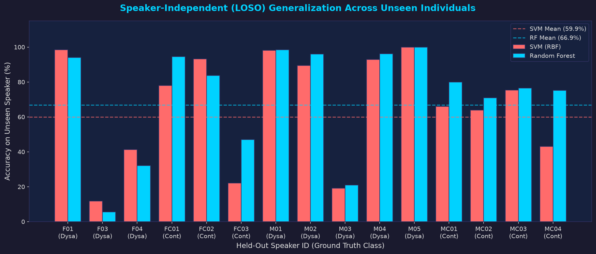

<div align="center">

# 🎙️ TORGO Dysarthric Speech Disorder Detection

### A 6-Phase Machine Learning Pipeline for Automatic Detection of Dysarthric Speech

[](https://python.org)
[](https://scikit-learn.org)
[](https://librosa.org)
[](LICENSE)
[]()

<br/>

> **Binary Classification** · Dysarthric Speech vs. Healthy Control · SVM + Random Forest · LOSO Evaluation

</div>

---

## 📖 Table of Contents

| Section | Description |
|---------|-------------|
| [🧠 Overview](#-overview) | Project summary and goals |
| [📦 Dataset](#-dataset) | TORGO database details |
| [⚙️ Pipeline](#️-pipeline-phases) | 6-phase ML workflow |
| [🤖 Models](#-models) | Classifiers and evaluation |
| [📊 Results & Visuals](#-results--visuals) | Charts, metrics, LOSO scores |
| [🛠️ Installation](#️-installation) | Setup guide |
| [🚀 Usage](#-usage) | Run commands |
| [📓 Notebooks](#-notebooks) | EDA notebooks |
| [🌐 API](#-api) | REST inference API |

---

## 🧠 Overview

This project implements an **end-to-end machine learning pipeline** for **automatic dysarthric speech disorder detection** using the TORGO database. It classifies speakers as either *dysarthric* or *healthy control* by extracting rich acoustic features from raw audio and training classical ML classifiers.

```
Raw Audio (.wav) ──► Feature Extraction ──► ML Classifiers ──► Dysarthric / Control
```

| Property | Value |
|----------|-------|
| **Task** | Binary Classification |
| **Classes** | `Control (0)` vs `Dysarthric (1)` |
| **Audio Format** | arrayMic WAV @ 16,000 Hz |
| **Total Samples** | 9,410 utterances |
| **Speakers** | 15 (7 control + 8 dysarthric) |
| **Features** | MFCCs, Delta, Pitch, ZCR, Spectral features |
| **Evaluation** | 5-Fold CV + LOSO (Leave-One-Speaker-Out) |

---

## 📦 Dataset

This project uses the **[TORGO Database](http://www.cs.toronto.edu/~complingweb/data/TORGO/torgo.html)** — a benchmark corpus recorded at the University of Toronto, containing speech from individuals with cerebral palsy (dysarthric) and age/gender-matched healthy controls.

| Category | Speakers | Gender | Label | Samples |
|----------|----------|--------|-------|---------|
| `F_Con` | FC01, FC02, FC03 | Female | Control (0) | 2,511 |
| `F_Dys` | F01, F03, F04 | Female | Dysarthric (1) | 1,428 |
| `M_Con` | MC01–MC04 | Male | Control (0) | 3,721 |
| `M_Dys` | M01–M05 | Male | Dysarthric (1) | 1,750 |

> ⚠️ **Audio data not included** (~1.77 GB). Download from the [TORGO website](http://www.cs.toronto.edu/~complingweb/data/TORGO/torgo.html) and place folders inside `torgo/`.

---

## 📁 Project Structure

```
torgo-speech-disorder-detection/
│
├── 📂 torgo/                            # Core ML pipeline
│   ├── 🔵 phase1_data_loading.py        # Scan & catalog WAV files
│   ├── 🔵 phase2_feature_extraction.py  # MFCC, pitch, spectral features
│   ├── 🔵 phase3_preprocessing.py       # Normalize, split, balance
│   ├── 🔵 phase4_model_training.py      # Train SVM + Random Forest
│   ├── 🔵 phase5_evaluation.py          # Metrics, ROC-AUC, reports
│   ├── 🔵 phase6_visualization.py       # Generate all charts
│   │
│   ├── ▶️  run_pipeline.py              # Main entry point
│   ├── ⚙️  config.py                    # All constants & paths
│   ├── 🔧 utils.py                     # Shared utilities
│   │
│   ├── 🔮 predict.py                   # Inference on new audio
│   ├── 🏭 train_production_model.py    # Export production bundle
│   ├── 📐 market_loso_evaluation.py    # LOSO speaker evaluation
│   ├── 🌐 api.py                       # REST API server
│   │
│   ├── 📂 models/
│   │   └── torgo_production_bundle.joblib
│   │
│   └── 📂 results/
│       ├── extracted_features.csv
│       ├── 01_class_distribution.png
│       ├── 02_confusion_matrices.png
│       ├── 03_roc_curves.png
│       ├── 04_feature_importances.png
│       ├── 05_model_comparison.png
│       ├── 06_loso_speaker_evaluation.png
│       └── speaker_independent_loso_report.json
│
├── 📂 notebooks/                        # Jupyter EDA notebooks
│   ├── 01_dataset_exploration.ipynb
│   ├── 02_audio_analysis.ipynb
│   ├── 03_waveform_features.ipynb
│   └── 04_pitch_f0_speaking_rate.ipynb
│
├── torgo_metadata.csv
├── torgo_waveform_features.csv
├── torgo_problem_files.csv
└── README.md
```

---

## ⚙️ Pipeline Phases

```
  ┌─────────┐    ┌─────────┐    ┌─────────┐    ┌─────────┐    ┌─────────┐    ┌─────────┐
  │ Phase 1 │───►│ Phase 2 │───►│ Phase 3 │───►│ Phase 4 │───►│ Phase 5 │───►│ Phase 6 │
  │  Load   │    │ Extract │    │  Prep   │    │  Train  │    │  Eval   │    │  Visual │
  └─────────┘    └─────────┘    └─────────┘    └─────────┘    └─────────┘    └─────────┘
```

| # | Phase | Script | What it does |
|---|-------|--------|--------------|
| **1** | 🗂️ Data Loading | `phase1_data_loading.py` | Traverses `F_Con/`, `F_Dys/`, `M_Con/`, `M_Dys/` directories; catalogs all `arrayMic` `.wav` files; assigns binary labels; checks class balance |
| **2** | 🎛️ Feature Extraction | `phase2_feature_extraction.py` | Extracts 13 MFCCs + Δ + ΔΔ (39 coefficients), fundamental frequency (F0/pitch), Zero Crossing Rate, Spectral Centroid, Rolloff & Bandwidth per utterance |
| **3** | 🔧 Preprocessing | `phase3_preprocessing.py` | `StandardScaler` normalization; stratified 80/20 train-test split; handles class imbalance via `class_weight='balanced'` |
| **4** | 🤖 Model Training | `phase4_model_training.py` | Trains SVM (RBF kernel) and Random Forest (100 trees); runs 5-fold stratified cross-validation on both |
| **5** | 📐 Evaluation | `phase5_evaluation.py` | Classification report (Precision/Recall/F1); Confusion Matrix; ROC-AUC; head-to-head comparison; RF feature importances |
| **6** | 📊 Visualization | `phase6_visualization.py` | Saves 6 publication-quality charts to `results/` |

---

## 🤖 Models

### Support Vector Machine (SVM)
```python
SVC(kernel="rbf", C=1.0, gamma="scale",
    class_weight="balanced", probability=True)
```

### Random Forest
```python
RandomForestClassifier(n_estimators=100, max_depth=None,
                       class_weight="balanced", n_jobs=-1)
```

### Evaluation Protocol
- ✅ **5-Fold Stratified Cross-Validation** — ensures balanced folds
- ✅ **LOSO (Leave-One-Speaker-Out)** — speaker-independent evaluation (gold standard)
- ✅ **ROC-AUC** — handles class imbalance robustly
- ✅ **Weighted F1** — balances precision and recall

---

## 📊 Results & Visuals

### 🏆 LOSO (Speaker-Independent) Performance

| Speaker | Category | Ground Truth | SVM Acc | RF Acc |
|---------|----------|--------------|---------|--------|
| F01 | F_Dys | Dysarthric | 98.5% | 94.0% |
| F03 | F_Dys | Dysarthric | 11.7% | 5.6% |
| F04 | F_Dys | Dysarthric | 41.3% | 32.1% |
| FC01 | F_Con | Control | 78.0% | 94.5% |
| FC02 | F_Con | Control | 93.2% | 83.7% |
| FC03 | F_Con | Control | 22.1% | 46.9% |
| M01 | M_Dys | Dysarthric | 98.2% | 98.4% |
| M02 | M_Dys | Dysarthric | 89.5% | 96.0% |
| M03 | M_Dys | Dysarthric | 19.2% | 20.9% |
| M04 | M_Dys | Dysarthric | 92.9% | 96.2% |
| M05 | M_Dys | Dysarthric | **100.0%** | **100.0%** |
| MC01 | M_Con | Control | 66.0% | 79.9% |
| MC02 | M_Con | Control | 63.9% | 70.9% |
| MC03 | M_Con | Control | 75.4% | 76.5% |
| MC04 | M_Con | Control | 43.0% | 75.1% |
| **Weighted Overall** | | | **59.9%** | **66.9%** |

> 📌 LOSO is harder than standard CV since the model never sees any audio from the test speaker. Per-speaker variance reflects dysarthria severity.

---

### 📈 Visual Results

#### 1️⃣ Class Distribution


---

#### 2️⃣ Confusion Matrices — SVM vs Random Forest


---

#### 3️⃣ ROC Curves


---

#### 4️⃣ Top Feature Importances (Random Forest)


---

#### 5️⃣ Model Comparison


---

#### 6️⃣ Per-Speaker LOSO Accuracy


---

## 🛠️ Installation

### Step 1 — Clone the repo
```bash
git clone https://github.com/RUPESHSPARCHANI/torgo-speech-disorder-detection.git
cd torgo-speech-disorder-detection
```

### Step 2 — Create virtual environment
```bash
python -m venv .venv

# Windows
.venv\Scripts\activate

# macOS / Linux
source .venv/bin/activate
```

### Step 3 — Install dependencies
```bash
pip install librosa scikit-learn pandas numpy matplotlib seaborn joblib flask
```

### Step 4 — Download TORGO dataset
Download from the [TORGO website](http://www.cs.toronto.edu/~complingweb/data/TORGO/torgo.html) and place inside `torgo/`:
```
torgo/
├── F_Con/   ← Female Control speakers  (FC01, FC02, FC03)
├── F_Dys/   ← Female Dysarthric speakers (F01, F03, F04)
├── M_Con/   ← Male Control speakers    (MC01–MC04)
└── M_Dys/   ← Male Dysarthric speakers  (M01–M05)
```

### Step 5 — Configure paths
Edit `torgo/config.py`:
```python
BASE_DIR = Path(r"path\to\your\torgo")   # Windows
# or
BASE_DIR = Path("path/to/your/torgo")    # macOS/Linux
```

---

## 🚀 Usage

### ▶️ Run the full 6-phase pipeline
```bash
cd torgo
python run_pipeline.py
```

### 🔵 Run individual phases
```bash
python phase1_data_loading.py        # Scan & catalog dataset
python phase2_feature_extraction.py  # Extract audio features
python phase3_preprocessing.py       # Normalize & split
python phase4_model_training.py      # Train classifiers
python phase5_evaluation.py          # Evaluate & compare
python phase6_visualization.py       # Generate charts
```

### 🔮 Predict on a new audio file
```bash
python predict.py --audio path/to/speech.wav
```

### 🏭 Train & export production model
```bash
python train_production_model.py
```

### 📐 Run LOSO speaker-independent evaluation
```bash
python market_loso_evaluation.py
```

### 🌐 Start the REST API
```bash
python api.py
```

---

## 📓 Notebooks

| Notebook | Description |
|----------|-------------|
| [`01_dataset_exploration.ipynb`](notebooks/01_dataset_exploration.ipynb) | File counts, label distribution, speaker breakdown |
| [`02_audio_analysis.ipynb`](notebooks/02_audio_analysis.ipynb) | Waveform & spectrogram visualization |
| [`03_waveform_features.ipynb`](notebooks/03_waveform_features.ipynb) | Feature extraction & distributions |
| [`04_pitch_f0_speaking_rate.ipynb`](notebooks/04_pitch_f0_speaking_rate.ipynb) | Fundamental frequency and speaking rate analysis |

---

## 🌐 API

The `api.py` module provides a lightweight REST API for real-time inference.

**Start server:**
```bash
python api.py
```

**Endpoint:**
```http
POST /predict
Content-Type: multipart/form-data
```

**Example (curl):**
```bash
curl -X POST http://localhost:5000/predict \
     -F "audio=@path/to/speech.wav"
```

**Response:**
```json
{
  "prediction": "Dysarthric",
  "confidence": 0.92,
  "label": 1
}
```

---

## 🗺️ Roadmap

- [x] 6-Phase ML pipeline (SVM + Random Forest)
- [x] LOSO speaker-independent evaluation
- [x] REST API for inference
- [ ] Deep learning models (CNN, LSTM on spectrograms)
- [ ] Real-time microphone input support
- [ ] Web dashboard for clinicians

---

## 📄 License

This project is licensed under the **MIT License** — see [LICENSE](LICENSE) for details.

---

## 👤 Author

<div align="center">

**Rupesh S. Parchani**

NIT Sikkim · B.Tech CSE

[](https://github.com/RUPESHSPARCHANI)

</div>

---

<div align="center">

*⭐ If you find this project useful, please consider giving it a star!*

</div>
